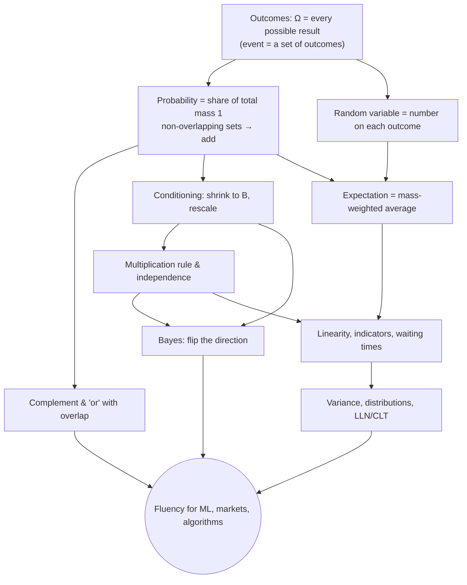

---

**You:** /teach i want to learn probability properly. I took stats i college, I did ok but i don't remember much.

Before mapping what you remember, I want to know what you're aiming for, because "probability properly" can mean very different courses depending on what it's for.

> **Goal: What do you mainly want probability for? Pick all that apply.**
>
> - ML / AI — Understanding the probability behind machine learning, LLMs, Bayesian models, etc.
> - Reading data & studies — Making sense of statistics, p-values, studies and claims you run into.
> - Everyday reasoning — Better intuition for risk, odds, decisions and Bayesian updating in real life.
> - The math itself — A solid foundation in the subject: definitions, theorems, derivations.

> **Depth: How deep do you want to go?**
>
> - Solid intuition — Understand the core ideas deeply, with light math.
> - Working fluency — Comfortable doing calculations: distributions, expectation, Bayes, etc.
> - Rigorous — Proof-level understanding, building up toward measure-theoretic ideas eventually.

> *Answer:* The user answered: "What do you mainly want probability for? Pick all that apply."="ML / AI, The math itself, Everyday reasoning, Reading data & studies, "i want to deeply learn ML, stock market analysis, data structures and algorithms. I think stats and probability is a base for all fo these and it was my weakest link."", "How deep do you want to go?"="Working fluency". Read the answers carefully — they may request clarification, changes, or that you not proceed — and follow what they actually say.

> **Quiz: You roll a fair six-sided die 4 times. What is the probability of getting at least one 6?**
>
> - 4 · (1/6) — = 2/3
> - (1/6)^4 — ≈ 0.0008
> - 1 − (5/6)^4 — ≈ 0.518
> - 1 − (1/6)^4 — ≈ 0.999

> *Answer:* Your questions have been answered: "You roll a fair six-sided die 4 times. What is the probability of getting at least one 6?"="4 · (1/6)". You can now continue with these answers in mind.

> **Quiz: You roll a fair die twice. What is the probability that both rolls are 6?**
>
> - 1/6 + 1/6 — = 1/3
> - 1/6 — ≈ 0.167
> - 1/6 · 1/6 — = 1/36
> - 1/6 · 1/2 — = 1/12

> *Answer:* Your questions have been answered: "You roll a fair die twice. What is the probability that both rolls are 6?"="1/6 + 1/6". You can now continue with these answers in mind.

> **Quiz: You roll two fair dice (say one red, one blue). How many different equally likely outcomes are there?**
>
> - 11 — the possible sums 2 through 12
> - 36 — every (red, blue) pair
> - 21 — every unordered pair of faces
> - 12 — 6 faces on each die

> *Answer:* The user answered: "You roll two fair dice (say one red, one blue). How many different equally likely outcomes are there?"="i genuinely meant to select 1/6 * 1/6 for that last one. for this one i say 36 (2)". Read the answers carefully — they may request clarification, changes, or that you not proceed — and follow what they actually say.

> **Quiz: You roll two fair dice. What is the probability that at least one of them shows a 6?**
>
> - 10/36 — ≈ 0.278
> - 1/36 — ≈ 0.028
> - 12/36 — ≈ 0.333
> - 11/36 — ≈ 0.306

> *Answer:* Your questions have been answered: "You roll two fair dice. What is the probability that at least one of them shows a 6?"="12/36". You can now continue with these answers in mind.

> **Quiz: You roll two fair dice and are told the sum is 8. Given that, what is the probability that at least one die shows a 6?**
>
> - 11/36 — ≈ 0.306
> - 2/5 — = 0.4
> - 2/36 — ≈ 0.056
> - 1/5 — = 0.2

> *Answer:* The user answered: "You roll two fair dice and are told the sum is 8. Given that, what is the probability that at least one die shows a 6?"="no clue". Read the answers carefully — they may request clarification, changes, or that you not proceed — and follow what they actually say.

> **Quiz: A card is drawn from a standard 52-card deck. You're told it's red. What's the probability that it's a heart?**
>
> - 1/4 — 13 hearts out of 52 cards
> - 1/2 — 13 hearts out of 26 red cards
> - 1/8 — 1/4 · 1/2
> - 1/13 — 1 heart rank out of 13

> *Answer:* The user answered: "A card is drawn from a standard 52-card deck. You're told it's red. What's the probability that it's a heart?"="Okay this is: what is the probability that it's a heart given it's red, right? Isn't that the formula, kind of like the probability of a heart given it's red? First it's red. That is 26. Out of the 26 red cards either diamond or heart, so I'm going to say it's number 2. ". Read the answers carefully — they may request clarification, changes, or that you not proceed — and follow what they actually say.

> **Quiz: You roll a fair die 12 times. On average, how many 6s do you expect to get?**
>
> - 1 − (5/6)^12 — ≈ 0.89
> - 2 — 12 · (1/6)
> - 1 — one 6 per run
> - 1/6 — ≈ 0.167

> *Answer:* Your questions have been answered: "You roll a fair die 12 times. On average, how many 6s do you expect to get?"="2". You can now continue with these answers in mind.

✓ Correct, 2. Each roll contributes $\frac16$ of a six on average, and averages add, so the total is $12 \cdot \frac16 = 2$.

Now a harder one:

> **Quiz: You roll a fair die repeatedly until the first 6 appears. On average, how many rolls does that take (counting the roll that shows the 6)?**
>
> - 3 — rolls
> - 4 — rolls
> - 3.5 — rolls
> - 6 — rolls

> *Answer:* Your questions have been answered: "You roll a fair die repeatedly until the first 6 appears. On average, how many rolls does that take (counting the roll that shows the 6)?"="3". You can now continue with these answers in mind.

> **Quiz: 1% of people have a disease. A test catches 90% of people who have it, but also wrongly flags 9% of healthy people. Someone tests positive. Roughly how likely is it that they actually have the disease?**
>
> - About 90%
> - About 9%
> - About 50%
> - About 1%

> *Answer:* Your questions have been answered: "1% of people have a disease. A test catches 90% of people who have it, but also wrongly flags 9% of healthy people. Someone tests positive. Roughly how likely is it that they actually have the disease?"="About 90%". You can now continue with these answers in mind.

I'll show you the plan once the research comes back. It should only take a minute.

This is the plan. I'll wait for your go-ahead before starting.

## Approach

There's one idea underneath all four of the places where you ran out. **A probability is just the share of the total that a set of outcomes takes up.** Picture a fixed amount of "probability mass", totalling exactly 1, spread over every possible outcome. Every question you missed today comes down to one of two things: which outcomes are we counting, and are we counting any of them twice? Once that picture is solid:

- **"Or" / "at least one"** is adding up mass without counting the overlap twice. This fixes your adding habit.
- **Conditioning** is throwing away every outcome outside what you were told, then rescaling what's left so it totals 1 again. You already did this with "given red". We'll make it something you can do on purpose.
- **Bayes** is conditioning done in the reverse direction. That's the 90%-vs-9% mix-up.
- **Random variables and expectation** are a number attached to each outcome, averaged by its share of the mass. That leads to waiting times, indicators, and later variance and distributions. ML, market returns and algorithm analysis all live there.

**Session 1** covers the mass picture, then "or" questions, conditioning and Bayes. That fixes the three earliest gaps. **Session 2** covers random variables, expectation, linearity and the waiting-time answer of 6. **Later sessions** cover variance, the named distributions (binomial, geometric, Poisson, normal) and the law of large numbers / central limit theorem, all built on the same picture.

Most steps will be you working them out, since you clearly can reason through these. I'll explain directly only where a step would be hard to find cold.

## Dependency map

**Starting points.** The map rests on two facts: (1) every experiment has a set of all possible outcomes, and (2) probability is mass totalling 1 that you add up across outcomes that don't overlap. These are the standard axioms of probability (Kolmogorov, 1933), stated plainly. They really are the bottom layer, not results proved from something simpler. Everything else on the map is built from them. The "equally likely" counting rule, $P(A) = \frac{|A|}{|\Omega|}$, you'd normally use as the definition, so I'll treat it as a special case. It holds only when every outcome has the same share.

**A free companion if you want one:** Blitzstein & Hwang's *Introduction to Probability* (Harvard Stat 110), which has a free online edition and free YouTube lectures. It covers the topics in this same order.

Does this scope and starting point work for you? Or would you like a different order, for example jumping to expected value sooner because of algorithms?

---

**You:** <task-notification>
<task-id>a0156e1300ff93c88</task-id>
<tool-use-id>toolu_01KukQ5N71VQPhL5DdXUduJm</tool-use-id>
<output-file>/tmp/claude-1000/-home-user-code-learn/021d352b-42ad-43d3-9f31-1529680cec94/tasks/a0156e1300ff93c88.output</output-file>
<status>completed</status>

Agent "Scope intro probability curriculum" finished

<note>A task-notification fires each time this agent stops with no live background children of its own. The user can send it another message and resume it, so the same task-id may notify more than once.</note>
<result>This agent's report was delivered to you as a message from "a0156e1300ff93c88" (its SubagentHandback call). Read it there; it is not repeated here.
</result>
<usage><subagent_tokens>26182</subagent_tokens><tool_uses>20</tool_uses><duration_ms>81065</duration_ms></usage>
</task-notification>

---

**You:** Hey I don't know if this is because I'm using Termius as my interface over an SSH connection but the output for fractions does not look right. I see something like `$\frac{1}{6}$` of a 6 on average in your earlier output.

> **Math format: How should I write math from here on?**
>
> - Plain text (Recommended) — Readable in your terminal right now. The lesson file will look a little less polished.
> - Keep LaTeX — Raw in the terminal; you read the rendered lesson file alongside.

> *Answer:* The user doesn't want to proceed with this tool use. The tool use was rejected (eg. if it was a file edit, the new_string was NOT written to the file). To tell you how to proceed, the user said: The user wants to clarify these questions.     This means they may have additional information, context or questions for you.     Take their response into account and then reformulate the questions if appropriate.     Start by asking them what they would like to clarify.     Questions asked: - "How should I write math from here on?"   (No answer provided) Note: The user's next message may contain a correction or preference. Pay close attention — if they explain what went wrong or how they'd prefer you to work, consider saving that to memory for future sessions.

Sure, what would you like to clarify? Do you have a question about the two options (plain text in the terminal or LaTeX in the lesson file), or about how you're reading these sessions in general?

---

**You:** The original project that this is a fork of, they got LaTeX to render in their terminal. So how come we can't do that? Should I just use iTerm on my Mac instead and SSH over? Should I just clone this and move this cloud session to my MacBook locally?

The original project didn't render LaTeX in the terminal either, so iTerm won't change anything. I checked its code. The pi extension that writes the session log (`extensions/md-log.ts`) says in its header that it exists because "markdown/math/code don't render" in the terminal. The log file "is meant to be viewed rendered (e.g. in Obsidian)". If the demo video looked like math in a terminal, it was almost certainly Obsidian open next to the terminal, showing the log as it updates. I haven't watched the video, so I'm going by the code here.

The port works the same way. The Stop hook writes `lessons/2026-10-22-…-021d352b.md` after each of my replies. What you need is a markdown viewer that can open that file:

- **Stay on SSH and use VS Code Remote-SSH.** Connect to this machine, open `lessons/`, and turn on markdown preview. LaTeX and mermaid diagrams render there, and the preview refreshes when the file changes. This is the least setup.
- **Clone it to your MacBook and run Claude Code locally.** Then open `lessons/` as an Obsidian vault and you get the original side-by-side setup. This session wouldn't move with you, but the lesson log would. We're still at the plan stage, so restarting would cost almost nothing. You'd run `(cd tools/render && PUPPETEER_SKIP_DOWNLOAD=1 npm install)` once so diagrams render.
- **Read only in Termius.** I'd switch to plain-text math like `P(A | B) = P(A ∩ B) / P(B)` and `(5/6)⁴`. It reads fine in the terminal and is a bit less polished in the log.

If you plan to make this a habit, cloning it to your Mac with Obsidian works best. Many of the lessons ahead are formula-heavy, and properly rendered math makes them much easier to read.

Which way do you want to go? Either way, the plan above is still waiting for your go-ahead.

---

**You:** i'll do vs code remote ssh for now. i approve the plan

Good, I'll keep writing LaTeX. With VS Code's preview open on the lesson file, the math will show as proper formulas.

# Node 1: Outcomes and events

**Why start here.** Look back at your misses today. Each one came from not knowing exactly *which outcomes* you were counting. Adding $\frac16 + \frac16$ counted (6,6) twice. On the "sum is 8" question you didn't have the five pairs in front of you. So before any probability, we need a precise way to say *what could happen*.

**Starting point 1: the sample space.** Every random experiment has a set of every possible result. That set is called the **sample space**, $\Omega$ (omega). Each time you run the experiment, *exactly one* outcome in $\Omega$ happens.

For two dice, $\Omega$ is the 6 × 6 grid of (red, blue) pairs, 36 outcomes:

| red \ blue | 1 | 2 | 3 | 4 | 5 | 6 |
|---|---|---|---|---|---|---|
| **1** | (1,1) | (1,2) | (1,3) | (1,4) | (1,5) | (1,6) |
| **2** | (2,1) | (2,2) | (2,3) | (2,4) | (2,5) | (2,6) |
| **3** | (3,1) | (3,2) | (3,3) | (3,4) | (3,5) | (3,6) |
| **4** | (4,1) | (4,2) | (4,3) | (4,4) | (4,5) | (4,6) |
| **5** | (5,1) | (5,2) | (5,3) | (5,4) | (5,5) | (5,6) |
| **6** | (6,1) | (6,2) | (6,3) | (6,4) | (6,5) | (6,6) |

**Starting point 2: an event is just a set of outcomes.** Any statement you could make about the result, like "sum is 8", "at least one 6" or "doubles", picks out some cells of that grid. That set of cells *is* the event. "The event happened" means exactly this: the one outcome that actually occurred is one of those cells.

This applies to every event, with no exceptions. Each one is a set of outcomes, a shaded region of $\Omega$.

**How this ties to the rest.** Everything that follows, including "or", "and", "given", Bayes and expected value, works by shading regions of this grid and comparing them. The questions that tripped you up today will turn into "which cells, each counted once?"

Quick check:

> **Quiz: Two dice are rolled. In the language we just set up, what *is* the event "the sum is 8"?**
>
> - The number 5/36
> - The set {2, 3, 4, 5, 6}
> - The set {(2,6), (3,5), (4,4), (5,3), (6,2)}
> - The number 8

> *Answer:* The user doesn't want to proceed with this tool use. The tool use was rejected (eg. if it was a file edit, the new_string was NOT written to the file). To tell you how to proceed, the user said: The user wants to clarify these questions.     This means they may have additional information, context or questions for you.     Take their response into account and then reformulate the questions if appropriate.     Start by asking them what they would like to clarify.     Questions asked: - "Two dice are rolled. In the language we just set up, what *is* the event "the sum is 8"?"   (No answer provided) Note: The user's next message may contain a correction or preference. Pay close attention — if they explain what went wrong or how they'd prefer you to work, consider saving that to memory for future sessions.
