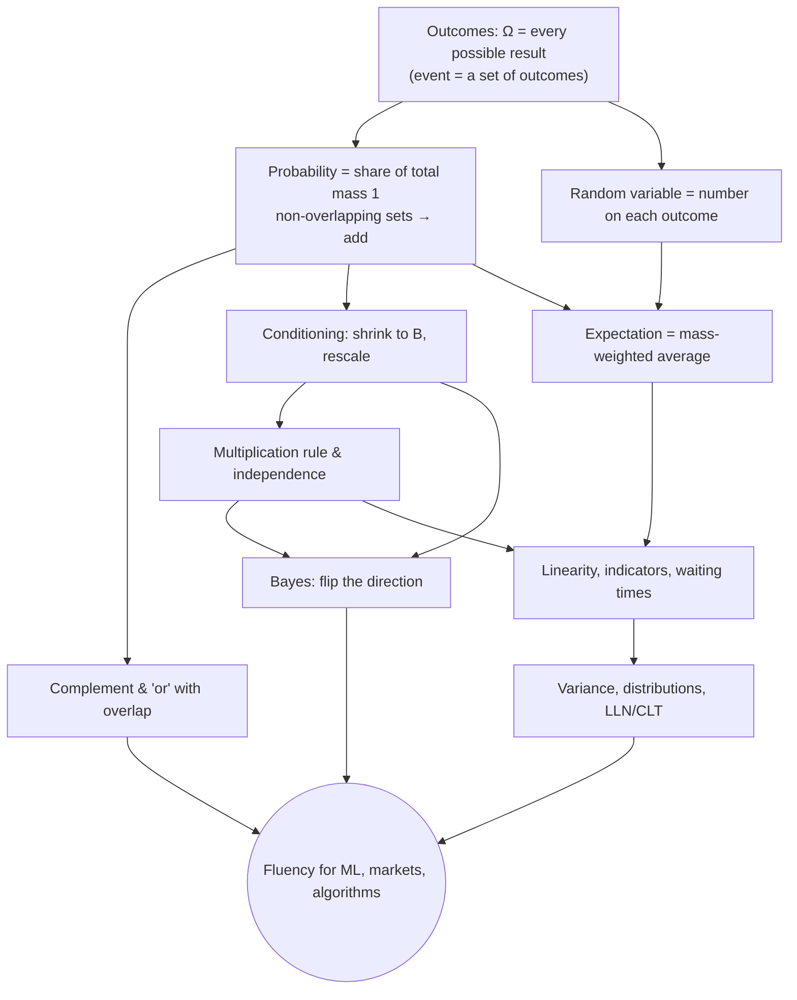
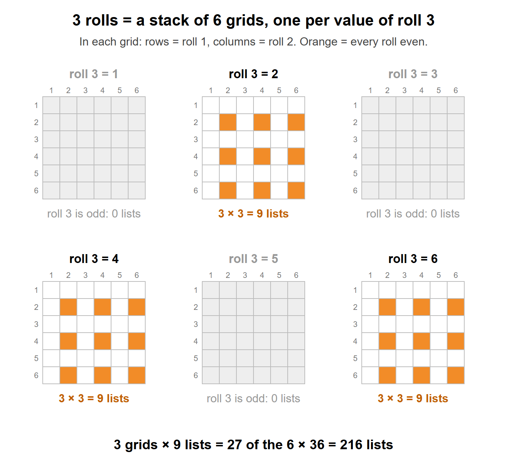

---

**You:** /teach i want to learn probability properly. I took stats i college, I did ok but i don't remember much.

Before mapping what you remember, I want to know what you're aiming for, because "probability properly" can mean very different courses depending on what it's for.

> **Goal: What do you mainly want probability for? Pick all that apply.**
>
> - ML / AI — Understanding the probability behind machine learning, LLMs, Bayesian models, etc.
> - Reading data & studies — Making sense of statistics, p-values, studies and claims you run into.
> - Everyday reasoning — Better intuition for risk, odds, decisions and Bayesian updating in real life.
> - The math itself — A solid foundation in the subject: definitions, theorems, derivations.

> **Depth: How deep do you want to go?**
>
> - Solid intuition — Understand the core ideas deeply, with light math.
> - Working fluency — Comfortable doing calculations: distributions, expectation, Bayes, etc.
> - Rigorous — Proof-level understanding, building up toward measure-theoretic ideas eventually.

> *Answer:* The user answered: "What do you mainly want probability for? Pick all that apply."="ML / AI, The math itself, Everyday reasoning, Reading data & studies, "i want to deeply learn ML, stock market analysis, data structures and algorithms. I think stats and probability is a base for all fo these and it was my weakest link."", "How deep do you want to go?"="Working fluency". Read the answers carefully — they may request clarification, changes, or that you not proceed — and follow what they actually say.

> **Quiz: You roll a fair six-sided die 4 times. What is the probability of getting at least one 6?**
>
> - 4 · (1/6) — = 2/3
> - (1/6)^4 — ≈ 0.0008
> - 1 − (5/6)^4 — ≈ 0.518
> - 1 − (1/6)^4 — ≈ 0.999

> *Answer:* Your questions have been answered: "You roll a fair six-sided die 4 times. What is the probability of getting at least one 6?"="4 · (1/6)". You can now continue with these answers in mind.

> **Quiz: You roll a fair die twice. What is the probability that both rolls are 6?**
>
> - 1/6 + 1/6 — = 1/3
> - 1/6 — ≈ 0.167
> - 1/6 · 1/6 — = 1/36
> - 1/6 · 1/2 — = 1/12

> *Answer:* Your questions have been answered: "You roll a fair die twice. What is the probability that both rolls are 6?"="1/6 + 1/6". You can now continue with these answers in mind.

> **Quiz: You roll two fair dice (say one red, one blue). How many different equally likely outcomes are there?**
>
> - 11 — the possible sums 2 through 12
> - 36 — every (red, blue) pair
> - 21 — every unordered pair of faces
> - 12 — 6 faces on each die

> *Answer:* The user answered: "You roll two fair dice (say one red, one blue). How many different equally likely outcomes are there?"="i genuinely meant to select 1/6 * 1/6 for that last one. for this one i say 36 (2)". Read the answers carefully — they may request clarification, changes, or that you not proceed — and follow what they actually say.

> **Quiz: You roll two fair dice. What is the probability that at least one of them shows a 6?**
>
> - 10/36 — ≈ 0.278
> - 1/36 — ≈ 0.028
> - 12/36 — ≈ 0.333
> - 11/36 — ≈ 0.306

> *Answer:* Your questions have been answered: "You roll two fair dice. What is the probability that at least one of them shows a 6?"="12/36". You can now continue with these answers in mind.

> **Quiz: You roll two fair dice and are told the sum is 8. Given that, what is the probability that at least one die shows a 6?**
>
> - 11/36 — ≈ 0.306
> - 2/5 — = 0.4
> - 2/36 — ≈ 0.056
> - 1/5 — = 0.2

> *Answer:* The user answered: "You roll two fair dice and are told the sum is 8. Given that, what is the probability that at least one die shows a 6?"="no clue". Read the answers carefully — they may request clarification, changes, or that you not proceed — and follow what they actually say.

> **Quiz: A card is drawn from a standard 52-card deck. You're told it's red. What's the probability that it's a heart?**
>
> - 1/4 — 13 hearts out of 52 cards
> - 1/2 — 13 hearts out of 26 red cards
> - 1/8 — 1/4 · 1/2
> - 1/13 — 1 heart rank out of 13

> *Answer:* The user answered: "A card is drawn from a standard 52-card deck. You're told it's red. What's the probability that it's a heart?"="Okay this is: what is the probability that it's a heart given it's red, right? Isn't that the formula, kind of like the probability of a heart given it's red? First it's red. That is 26. Out of the 26 red cards either diamond or heart, so I'm going to say it's number 2. ". Read the answers carefully — they may request clarification, changes, or that you not proceed — and follow what they actually say.

> **Quiz: You roll a fair die 12 times. On average, how many 6s do you expect to get?**
>
> - 1 − (5/6)^12 — ≈ 0.89
> - 2 — 12 · (1/6)
> - 1 — one 6 per run
> - 1/6 — ≈ 0.167

> *Answer:* Your questions have been answered: "You roll a fair die 12 times. On average, how many 6s do you expect to get?"="2". You can now continue with these answers in mind.

✓ Correct, 2. Each roll contributes $\frac16$ of a six on average, and averages add, so the total is $12 \cdot \frac16 = 2$.

Now a harder one:

> **Quiz: You roll a fair die repeatedly until the first 6 appears. On average, how many rolls does that take (counting the roll that shows the 6)?**
>
> - 3 — rolls
> - 4 — rolls
> - 3.5 — rolls
> - 6 — rolls

> *Answer:* Your questions have been answered: "You roll a fair die repeatedly until the first 6 appears. On average, how many rolls does that take (counting the roll that shows the 6)?"="3". You can now continue with these answers in mind.

> **Quiz: 1% of people have a disease. A test catches 90% of people who have it, but also wrongly flags 9% of healthy people. Someone tests positive. Roughly how likely is it that they actually have the disease?**
>
> - About 90%
> - About 9%
> - About 50%
> - About 1%

> *Answer:* Your questions have been answered: "1% of people have a disease. A test catches 90% of people who have it, but also wrongly flags 9% of healthy people. Someone tests positive. Roughly how likely is it that they actually have the disease?"="About 90%". You can now continue with these answers in mind.

I'll show you the plan once the research comes back. It should only take a minute.

This is the plan. I'll wait for your go-ahead before starting.

## Approach

There's one idea underneath all four of the places where you ran out. **A probability is just the share of the total that a set of outcomes takes up.** Picture a fixed amount of "probability mass", totalling exactly 1, spread over every possible outcome. Every question you missed today comes down to one of two things: which outcomes are we counting, and are we counting any of them twice? Once that picture is solid:

- **"Or" / "at least one"** is adding up mass without counting the overlap twice. This fixes your adding habit.
- **Conditioning** is throwing away every outcome outside what you were told, then rescaling what's left so it totals 1 again. You already did this with "given red". We'll make it something you can do on purpose.
- **Bayes** is conditioning done in the reverse direction. That's the 90%-vs-9% mix-up.
- **Random variables and expectation** are a number attached to each outcome, averaged by its share of the mass. That leads to waiting times, indicators, and later variance and distributions. ML, market returns and algorithm analysis all live there.

**Session 1** covers the mass picture, then "or" questions, conditioning and Bayes. That fixes the three earliest gaps. **Session 2** covers random variables, expectation, linearity and the waiting-time answer of 6. **Later sessions** cover variance, the named distributions (binomial, geometric, Poisson, normal) and the law of large numbers / central limit theorem, all built on the same picture.

Most steps will be you working them out, since you clearly can reason through these. I'll explain directly only where a step would be hard to find cold.

## Dependency map

**Starting points.** The map rests on two facts: (1) every experiment has a set of all possible outcomes, and (2) probability is mass totalling 1 that you add up across outcomes that don't overlap. These are the standard axioms of probability (Kolmogorov, 1933), stated plainly. They really are the bottom layer, not results proved from something simpler. Everything else on the map is built from them. The "equally likely" counting rule, $P(A) = \frac{|A|}{|\Omega|}$, you'd normally use as the definition, so I'll treat it as a special case. It holds only when every outcome has the same share.

**A free companion if you want one:** Blitzstein & Hwang's *Introduction to Probability* (Harvard Stat 110), which has a free online edition and free YouTube lectures. It covers the topics in this same order.

Does this scope and starting point work for you? Or would you like a different order, for example jumping to expected value sooner because of algorithms?

---

**You:** <task-notification>
<task-id>a0156e1300ff93c88</task-id>
<tool-use-id>toolu_01KukQ5N71VQPhL5DdXUduJm</tool-use-id>
<output-file>/tmp/claude-1000/-home-user-code-learn/021d352b-42ad-43d3-9f31-1529680cec94/tasks/a0156e1300ff93c88.output</output-file>
<status>completed</status>

Agent "Scope intro probability curriculum" finished

<note>A task-notification fires each time this agent stops with no live background children of its own. The user can send it another message and resume it, so the same task-id may notify more than once.</note>
<result>This agent's report was delivered to you as a message from "a0156e1300ff93c88" (its SubagentHandback call). Read it there; it is not repeated here.
</result>
<usage><subagent_tokens>26182</subagent_tokens><tool_uses>20</tool_uses><duration_ms>81065</duration_ms></usage>
</task-notification>

---

**You:** Hey I don't know if this is because I'm using Termius as my interface over an SSH connection but the output for fractions does not look right. I see something like `$\frac{1}{6}$` of a 6 on average in your earlier output.

> **Math format: How should I write math from here on?**
>
> - Plain text (Recommended) — Readable in your terminal right now. The lesson file will look a little less polished.
> - Keep LaTeX — Raw in the terminal; you read the rendered lesson file alongside.

> *Answer:* The user doesn't want to proceed with this tool use. The tool use was rejected (eg. if it was a file edit, the new_string was NOT written to the file). To tell you how to proceed, the user said: The user wants to clarify these questions.     This means they may have additional information, context or questions for you.     Take their response into account and then reformulate the questions if appropriate.     Start by asking them what they would like to clarify.     Questions asked: - "How should I write math from here on?"   (No answer provided) Note: The user's next message may contain a correction or preference. Pay close attention — if they explain what went wrong or how they'd prefer you to work, consider saving that to memory for future sessions.

Sure, what would you like to clarify? Do you have a question about the two options (plain text in the terminal or LaTeX in the lesson file), or about how you're reading these sessions in general?

---

**You:** The original project that this is a fork of, they got LaTeX to render in their terminal. So how come we can't do that? Should I just use iTerm on my Mac instead and SSH over? Should I just clone this and move this cloud session to my MacBook locally?

The original project didn't render LaTeX in the terminal either, so iTerm won't change anything. I checked its code. The pi extension that writes the session log (`extensions/md-log.ts`) says in its header that it exists because "markdown/math/code don't render" in the terminal. The log file "is meant to be viewed rendered (e.g. in Obsidian)". If the demo video looked like math in a terminal, it was almost certainly Obsidian open next to the terminal, showing the log as it updates. I haven't watched the video, so I'm going by the code here.

The port works the same way. The Stop hook writes `lessons/2026-10-22-…-021d352b.md` after each of my replies. What you need is a markdown viewer that can open that file:

- **Stay on SSH and use VS Code Remote-SSH.** Connect to this machine, open `lessons/`, and turn on markdown preview. LaTeX and mermaid diagrams render there, and the preview refreshes when the file changes. This is the least setup.
- **Clone it to your MacBook and run Claude Code locally.** Then open `lessons/` as an Obsidian vault and you get the original side-by-side setup. This session wouldn't move with you, but the lesson log would. We're still at the plan stage, so restarting would cost almost nothing. You'd run `(cd tools/render && PUPPETEER_SKIP_DOWNLOAD=1 npm install)` once so diagrams render.
- **Read only in Termius.** I'd switch to plain-text math like `P(A | B) = P(A ∩ B) / P(B)` and `(5/6)⁴`. It reads fine in the terminal and is a bit less polished in the log.

If you plan to make this a habit, cloning it to your Mac with Obsidian works best. Many of the lessons ahead are formula-heavy, and properly rendered math makes them much easier to read.

Which way do you want to go? Either way, the plan above is still waiting for your go-ahead.

---

**You:** i'll do vs code remote ssh for now. i approve the plan

Good, I'll keep writing LaTeX. With VS Code's preview open on the lesson file, the math will show as proper formulas.

# Node 1: Outcomes and events

**Why start here.** Look back at your misses today. Each one came from not knowing exactly *which outcomes* you were counting. Adding $\frac16 + \frac16$ counted (6,6) twice. On the "sum is 8" question you didn't have the five pairs in front of you. So before any probability, we need a precise way to say *what could happen*.

**Starting point 1: the sample space.** Every random experiment has a set of every possible result. That set is called the **sample space**, $\Omega$ (omega). Each time you run the experiment, *exactly one* outcome in $\Omega$ happens.

For two dice, $\Omega$ is the 6 × 6 grid of (red, blue) pairs, 36 outcomes:

| red \ blue | 1 | 2 | 3 | 4 | 5 | 6 |
|---|---|---|---|---|---|---|
| **1** | (1,1) | (1,2) | (1,3) | (1,4) | (1,5) | (1,6) |
| **2** | (2,1) | (2,2) | (2,3) | (2,4) | (2,5) | (2,6) |
| **3** | (3,1) | (3,2) | (3,3) | (3,4) | (3,5) | (3,6) |
| **4** | (4,1) | (4,2) | (4,3) | (4,4) | (4,5) | (4,6) |
| **5** | (5,1) | (5,2) | (5,3) | (5,4) | (5,5) | (5,6) |
| **6** | (6,1) | (6,2) | (6,3) | (6,4) | (6,5) | (6,6) |

**Starting point 2: an event is just a set of outcomes.** Any statement you could make about the result, like "sum is 8", "at least one 6" or "doubles", picks out some cells of that grid. That set of cells *is* the event. "The event happened" means exactly this: the one outcome that actually occurred is one of those cells.

This applies to every event, with no exceptions. Each one is a set of outcomes, a shaded region of $\Omega$.

**How this ties to the rest.** Everything that follows, including "or", "and", "given", Bayes and expected value, works by shading regions of this grid and comparing them. The questions that tripped you up today will turn into "which cells, each counted once?"

Quick check:

> **Quiz: Two dice are rolled. In the language we just set up, what *is* the event "the sum is 8"?**
>
> - The number 5/36
> - The set {2, 3, 4, 5, 6}
> - The set {(2,6), (3,5), (4,4), (5,3), (6,2)}
> - The number 8

> *Answer:* The user doesn't want to proceed with this tool use. The tool use was rejected (eg. if it was a file edit, the new_string was NOT written to the file). To tell you how to proceed, the user said: The user wants to clarify these questions.     This means they may have additional information, context or questions for you.     Take their response into account and then reformulate the questions if appropriate.     Start by asking them what they would like to clarify.     Questions asked: - "Two dice are rolled. In the language we just set up, what *is* the event "the sum is 8"?"   (No answer provided) Note: The user's next message may contain a correction or preference. Pay close attention — if they explain what went wrong or how they'd prefer you to work, consider saving that to memory for future sessions.

---

**You:** (Resumed in Cursor, reading the log in Obsidian.) Let's continue.

Picking up where we left off: the quick check for Node 1 got interrupted, so here it is again.

> **Quiz: Two dice are rolled. In the language we just set up, what *is* the event "the sum is 8"?**
>
> - A. The number $\frac{5}{36}$
> - B. The set $\{2, 3, 4, 5, 6\}$
> - C. The set $\{(2,6), (3,5), (4,4), (5,3), (6,2)\}$
> - D. The number $8$

> *Answer:* C

✓ Correct: C. The event *is* the set of cells: $\{(2,6), (3,5), (4,4), (5,3), (6,2)\}$. The other options are things you can *get from* the event, not the event itself. $8$ is the sum each of those cells shares. $\frac{5}{36}$ is the event's probability, which we're about to define. $\{2,3,4,5,6\}$ lists the faces that show up, but it drops the pairing. For example, it can't tell $(2,6)$ apart from $(6,2)$, and it doesn't say which faces go together.

# Node 2: Probability is a share of a fixed total

**Why we need this now.** We can now *name* any event as a set of cells. We still can't say *how likely* it is. We need a rule that assigns a number to every set of cells, and it has to stay consistent no matter which event we ask about.

**Unconditional truth: probability is mass that totals exactly 1.** Picture a total amount of "probability mass" equal to $1$, spread over the outcomes in $\Omega$. Every outcome gets a share that's $\ge 0$, and all the shares add up to exactly $1$, because *something* always happens. The probability of an event is the **total mass sitting on its cells**:

$$
P(A) = \text{sum of the shares of the outcomes in } A
$$

This holds for every event, with no exceptions. It's the definition.

**What follows right away: events that don't overlap add.** If $A$ and $B$ share no cells, then the mass on "$A$ or $B$" is just $A$'s mass plus $B$'s mass. No cell gets counted twice, because no cell belongs to both. *Adding is only safe when there's no overlap.* That's the exact condition your $\frac16 + \frac16$ answer broke, and we'll deal with it in the next node.

**The equally likely special case.** With fair dice, all 36 cells get the same share. The shares must total $1$, so each cell gets $\frac{1}{36}$. Then

$$
P(A) = \frac{\text{number of cells in } A}{36}
$$

So "sum is 8" has 5 cells, which gives $P = \frac{5}{36}$. That's option A from the last question. Counting cells only works because the shares are equal. The real rule is always "add up the mass."

**How this ties to Node 1.** Node 1 told us *which* cells an event covers. Node 2 tells us how much each cell weighs. A probability is just those two combined.

> **Quiz: Two fair dice are rolled. What is $P(\text{the sum is 7 or the roll is doubles})$?**
>
> - A. $\frac{12}{36}$
> - B. $\frac{11}{36}$
> - C. $\frac{1}{36}$
> - D. $\frac{6}{36}$

> *Answer:* "The sum is seven: 1 and 6, 2 and 5, 3 and 4, 4 and 3, 5 and 2, 6 and 1. That's seven outcomes, so 7/36. Doubles: there are six, so 6/36. Seven or doubles? I don't know how to combine those."

The pairs you listed are exactly right. Count the list again, though: there are **six** of them, not seven. So $P(\text{sum } 7) = \frac{6}{36}$. Your doubles count is correct: $\frac{6}{36}$.

Now the combining step. Don't combine the *numbers* yet. Go back to the *cells*. "Sum is 7 **or** doubles" is an event, so it's a set of cells: every cell that is in either group. Here is the grid with both groups marked. **7** marks a cell with sum 7, and **D** marks a doubles cell:

| red \ blue | 1 | 2 | 3 | 4 | 5 | 6 |
|---|---|---|---|---|---|---|
| **1** | D | · | · | · | · | 7 |
| **2** | · | D | · | · | 7 | · |
| **3** | · | · | D | 7 | · | · |
| **4** | · | · | 7 | D | · | · |
| **5** | · | 7 | · | · | D | · |
| **6** | 7 | · | · | · | · | D |

Look at the grid: **how many cells are marked in total, and does any cell carry both marks?** Once you have that, the probability is one step away, using the rule from Node 2.

> *Answer:* "Since they do not overlap at all, we can add the probabilities. So it's 12 out of 36, or one third. A."

✓ Correct: A, $\frac{12}{36} = \frac13$. The reasoning is exactly right too: you *checked for overlap first*, found none, and only then added. A doubles roll always has an even sum ($2a$), so it can never sum to 7. That's why the two groups can't share a cell.

The distractors:
- $\frac{11}{36}$ is what you'd get by assuming there's one shared cell and subtracting it.
- $\frac{1}{36} = \frac{6}{36}\cdot\frac{6}{36}$ multiplies, which is the rule for "and", not "or" (and it only works in some cases).
- $\frac{6}{36}$ counts only one of the two groups.

# Node 3: "Or" when the groups *do* overlap

**Why we need this now.** Adding worked because nothing overlapped. But plenty of "or" questions *do* overlap, and one of them is a question you missed this morning. So what happens when a cell is in both groups?

Here is "the red die shows 6" (**R**) and "the blue die shows 6" (**B**) on the same grid:

| red \ blue | 1 | 2 | 3 | 4 | 5 | 6 |
|---|---|---|---|---|---|---|
| **1** | · | · | · | · | · | B |
| **2** | · | · | · | · | · | B |
| **3** | · | · | · | · | · | B |
| **4** | · | · | · | · | · | B |
| **5** | · | · | · | · | · | B |
| **6** | R | R | R | R | R | **R B** |

Each group has 6 cells, so $P(R) = P(B) = \frac{6}{36}$. "At least one 6" means "$R$ or $B$": every cell with *any* mark.

> **Quiz: Two fair dice are rolled. What is $P(\text{at least one die shows a } 6)$?**
>
> - A. $\frac{12}{36}$
> - B. $\frac{10}{36}$
> - C. $\frac{11}{36}$
> - D. $\frac{1}{36}$

> *Answer:* C

✓ Correct: C, $\frac{11}{36}$. There are 11 distinct marked cells. This morning you answered $\frac{12}{36}$. The gap is exactly one cell: $(6,6)$. Adding $\frac{6}{36} + \frac{6}{36}$ puts that cell's mass in **twice**, once through the R row and once through the B column.

**How you could have discovered the general rule.** Adding the two groups' mass counts every cell once, *except* the cells in both groups, which get counted twice. So add, and then take the double-counted part back out once:

$$
P(A \text{ or } B) = P(A) + P(B) - P(A \text{ and } B)
$$

Here that's $\frac{6}{36} + \frac{6}{36} - \frac{1}{36} = \frac{11}{36}$. Node 2's "just add" rule is the special case where $P(A \text{ and } B) = 0$, because the groups share no cells.

**How this ties back.** This is the same overcount that made you answer $\frac16 + \frac16$ for "two 6s" earlier, and $4 \cdot \frac16$ for "at least one 6 in four rolls". With four rolls, the overlaps get messy fast (rolls 1 and 2 both 6, rolls 1, 2 and 3 all 6, and so on). The next node gives a much shorter route.

> **Quiz: You draw one card from a standard 52-card deck. What is $P(\text{heart or king})$?**
>
> - A. $\frac{17}{52}$
> - B. $\frac{16}{52}$
> - C. $\frac{15}{52}$
> - D. $\frac{1}{52}$

> *Answer:* "Heart is 13/52, king is 4/52, that adds to 17. But the king of hearts is counted twice: one of the four kings is also one of the thirteen hearts. So B, 16/52."

✓ Correct: B, $\frac{16}{52}$. You went straight to the reason, not just the formula: *"one of those four cards that could be king is one of those thirteen cards that could be a heart."* That's $P(A \text{ and } B)$, found by asking which cards are in both groups. The rule worked here on a deck of cards just as it did on dice, because it was never about dice. It's about cells being counted twice.

# Node 4: The complement, or counting what *didn't* happen

**Why we need this now.** "At least one 6 in four rolls" has overlaps on overlaps, so subtracting them out gets painful. Is there a group that's easier to count?

**Built from Node 2.** Every outcome either is in $A$ or isn't. Call the second group "not $A$". The two groups don't overlap, and together they cover all of $\Omega$. The total mass is $1$, so their masses must add to $1$:

$$
P(\text{not } A) = 1 - P(A)
$$

Nothing new is assumed here. It follows from "total mass is 1" plus "non-overlapping groups add". So when "$A$" is messy, count "not $A$" and subtract from 1.

**Try it on the grid.** The opposite of "at least one die shows a 6" is "**no** die shows a 6".

> **Quiz: Two fair dice are rolled. How many of the 36 cells have no 6 on either die?**
>
> - A. 30
> - B. 24
> - C. 26
> - D. 25

> *Answer:* C

✗ Not quite. The answer is D, **25**.

**Count it directly.** "No 6 on either die" means red is one of 1–5 *and* blue is one of 1–5. On the grid, that's the top-left block of rows 1–5 by columns 1–5, which has $5 \times 5 = 25$ cells.

| red \ blue | 1 | 2 | 3 | 4 | 5 | 6 |
|---|---|---|---|---|---|---|
| **1** | ✓ | ✓ | ✓ | ✓ | ✓ | · |
| **2** | ✓ | ✓ | ✓ | ✓ | ✓ | · |
| **3** | ✓ | ✓ | ✓ | ✓ | ✓ | · |
| **4** | ✓ | ✓ | ✓ | ✓ | ✓ | · |
| **5** | ✓ | ✓ | ✓ | ✓ | ✓ | · |
| **6** | · | · | · | · | · | · |

**Check it with the complement.** The cells *with* at least one 6 are exactly the 11 you counted in Node 3. Every cell is in one group or the other, never both, so the no-6 cells number $36 - 11 = 25$. If you got 26 as $36 - 10$, the $(6,6)$ corner was probably taken out twice: $6 + 6 - 2$ instead of $6 + 6 - 1$.

Both routes agree, and that's the complement rule working:

$$
P(\text{at least one 6}) = 1 - \frac{25}{36} = \frac{11}{36}
$$

> **Quiz: Two fair dice are rolled. How many of the 36 cells show neither a 1 nor a 2 on either die?**
>
> - A. 20
> - B. 16
> - C. 24
> - D. 12

> *Answer:* "Counting the grid: drop the first two rows and the first two columns, which leaves 4 × 4 = 16. With the formula: P(some 1) = 11/36, same for 2, total 21/36, but (1,2) and (2,1) are counted twice, so 19/36. Then 1 − 19/36 = 17/36. I'm off by one."

✓ Correct: B, **16**. Your grid count is right.

Checking it a second way and *noticing* that the two answers disagreed is exactly the right habit. Your formula route was also right. The only slip is arithmetic: $11 + 11 = 22$, not 21. Redo it with that:

$$
\underbrace{\tfrac{11}{36}}_{\text{some 1}} + \underbrace{\tfrac{11}{36}}_{\text{some 2}} - \underbrace{\tfrac{2}{36}}_{(1,2),\,(2,1)} = \tfrac{20}{36}
\qquad\Rightarrow\qquad
1 - \tfrac{20}{36} = \tfrac{16}{36}
$$

Both routes give 16. You also correctly found the overlap ("a 1 *and* a 2") as exactly the two cells $(1,2)$ and $(2,1)$.

**Now the payoff: this morning's first question.** With four rolls, an outcome is a list of four faces, such as $(3, 6, 1, 1)$. That's the same idea as a grid cell, just with four coordinates instead of two. Each coordinate has 6 options, so $|\Omega| = 6^4$. Ask the complement question: how many of those lists contain *no* 6?

> **Quiz: You roll a fair die 4 times. What is the probability of getting at least one 6?**
>
> - A. $4 \cdot \frac16$
> - B. $1 - \left(\frac16\right)^4$
> - C. $\left(\frac16\right)^4$
> - D. $1 - \left(\frac56\right)^4$

> *Answer:* A

✗ Not quite. The answer is D, $1 - \left(\frac56\right)^4 \approx 0.518$. This is the same answer you gave this morning, so the "multiply one roll's chance by the number of rolls" idea is still pulling. Let's dislodge it properly.

**First, a test that $4 \cdot \frac16$ can't pass.** Use the same rule for 7 rolls and you get $7 \cdot \frac16 = \frac76$, which is *more than 1*. Total mass is 1, so no event can ever have more than 1. The rule is broken. It's the two-dice mistake again: $4 \cdot \frac16$ is $\frac16+\frac16+\frac16+\frac16$, an "or" added up without removing the overlaps. Any list with two or more 6s, like $(6, 2, 6, 1)$, gets counted once for each 6 it contains.

**Now the complement, counted directly.** A list with no 6 has 5 choices (1 to 5) in each of its 4 positions, so there are $5^4$ such lists out of $6^4$. This is the $5 \times 5$ block from the grid, extended to four coordinates:

$$
P(\text{no 6}) = \frac{5^4}{6^4} = \left(\frac56\right)^4 \approx 0.482
\qquad\Rightarrow\qquad
P(\text{at least one 6}) = 1 - \left(\frac56\right)^4 \approx 0.518
$$

Compare: $4 \cdot \frac16 \approx 0.667$. The gap of about $0.15$ is all the double-counted overlap.

The other options:
- $\left(\frac16\right)^4$ counts lists that are *all* 6s: just $(6,6,6,6)$.
- $1 - \left(\frac16\right)^4$ is the complement of "all 6s", meaning "not every roll is a 6".

> **Quiz: You roll a fair die 3 times. What is the probability of getting at least one 6?**
>
> - A. $1 - \left(\frac16\right)^3$
> - B. $\left(\frac56\right)^3$
> - C. $1 - \left(\frac56\right)^3$
> - D. $3 \cdot \frac16$

> *Answer:* "Can we stay on this in terms of mass? Does 'at least one 6' also include two sixes, three sixes? I think the answer is C, but I don't see how we go from 1/6 per roll to bringing in the complement and subtracting (5/6)^3 from 1. That's where my gap is."

Yes, let's stay here. You're right that the answer is C, but the *why* matters more.

**Two quick fixes to the language.**
- $\Omega$ is the *set* of all outcomes. Its *size* is written $|\Omega|$. For 3 rolls, $|\Omega| = 6^3 = 216$ lists.
- "At least one 6" **does** include two 6s and three 6s. It means "one or more", so it covers every list with exactly one, exactly two, or exactly three 6s.

**Slicing the mass.** Sort all 216 lists by *how many 6s they contain*. Every list lands in exactly one slice. The slices don't overlap, and together they cover everything, so their masses add to 1:

| Slice | How to count it | Lists | Mass |
|---|---|---|---|
| no 6 | 5 choices in each of 3 slots: $5 \cdot 5 \cdot 5$ | 125 | $\frac{125}{216} \approx 0.58$ |
| exactly one 6 | choose which slot is the 6 (3 ways) × $5 \cdot 5$ for the others | 75 | $\frac{75}{216}$ |
| exactly two 6s | choose which slot *isn't* a 6 (3 ways) × 5 | 15 | $\frac{15}{216}$ |
| exactly three 6s | just $(6,6,6)$ | 1 | $\frac{1}{216}$ |
| **total** | | **216** | **1** |

"At least one 6" is the bottom three slices together: $75 + 15 + 1 = 91$ lists.

**Why the complement comes in.** You *could* count those three slices and add them, since they don't overlap. That works, but it's three separate counts. Look at what's left over: "at least one 6" is *everything except the top slice*. The top slice is one easy count, $5^3$. So:

$$
P(\text{at least one 6}) = 1 - P(\text{no 6}) = 1 - \frac{125}{216} = \frac{91}{216}
$$

That's the same 91 either way. The complement isn't a new idea. It's just "the whole bar minus the one piece we don't want."

**Where the $\frac56$ comes from.** It isn't "1 minus the per-roll chance" used as a trick. It comes straight from counting: $\frac{125}{216} = \frac{5 \cdot 5 \cdot 5}{6 \cdot 6 \cdot 6} = \left(\frac56\right)^3$. Each slot allows 5 of its 6 faces.

**Where $3 \cdot \frac16$ goes wrong, measured exactly.** $\frac16$ for "roll 1 is a 6" is $\frac{36}{216}$: the 36 lists that start with 6. Adding that for all three rolls gives $\frac{108}{216}$. Look at how often each slice gets counted:

- an exactly-one-6 list is counted **once** (75)
- an exactly-two-6s list, like $(6,6,2)$, is counted **twice**, once for roll 1 and once for roll 2 ($2 \times 15 = 30$)
- $(6,6,6)$ is counted **three times** ($3$)

$75 + 30 + 3 = 108$. The extra $108 - 91 = 17$ is exactly the overlap counted again.

> **Quiz: You flip a fair coin 5 times. What is the probability of getting at least one heads?**
>
> - A. $5 \cdot \frac12$
> - B. $1 - \left(\frac12\right)^5$
> - C. $\left(\frac12\right)^5$
> - D. $1 - 5 \cdot \frac12$

> *Answer:* "Can you explain the 'exactly one 6' line? What does 'pick which slot is the 6, 3 ways' mean? The six could be the first, second or third roll, but why does that mean we multiply 3 × 5 × 5?"

You've already found the key fact: *the six could be the first roll, the second roll, or the third roll.* Those are the "3 ways". Here's how that turns into $3 \times 5 \times 5$.

**First, why 5 and not 6.** A roll *can* show any of 6 faces. But in an "exactly one 6" list, the other two slots are **not allowed** to be 6, or the list would have two 6s. So each of those slots has only 5 options: 1, 2, 3, 4 or 5.

**Now split the slice into three groups,** one for each place the 6 can sit:

| Group | Shape | Examples | How many |
|---|---|---|---|
| 6 is roll 1 | $(6, \_, \_)$ | $(6,1,1),\ (6,1,2),\ \dots,\ (6,5,5)$ | $5 \times 5 = 25$ |
| 6 is roll 2 | $(\_, 6, \_)$ | $(1,6,1),\ (1,6,2),\ \dots,\ (5,6,5)$ | $5 \times 5 = 25$ |
| 6 is roll 3 | $(\_, \_, 6)$ | $(1,1,6),\ (1,2,6),\ \dots,\ (5,5,6)$ | $5 \times 5 = 25$ |

Each group is a $5 \times 5$ grid: the two blank slots, each 1–5. The three groups **don't overlap**. A list with exactly one 6 has that 6 in only one place, so it belongs to only one group. Groups that don't overlap add (Node 2):

$$
25 + 25 + 25 = 3 \times 25 = 75
$$

So the "3 ×" isn't a new rule. It's adding three equal, non-overlapping groups, written as a multiplication.

> **Quiz: You roll a fair die 2 times. How many of the 36 outcomes have *exactly one* 6?**
>
> - A. 11
> - B. 12
> - C. 10
> - D. 25

> *Answer:* "C. But I got it by counting cells. I'm trying to bridge counting cells to using the math, because with more rolls the slices get too big to visualize. How do I find how many outcomes don't have a six without looking at the grid?"

✓ Correct: C, **10**. Counting cells was a perfectly good method. You're asking exactly the right next question: how do you count without drawing the picture?

**The bridge: the grid already *is* a multiplication.** Why does the two-dice grid have 36 cells? Each row is one red value, and each row has 6 cells, one for each blue value. There are 6 rows, so $6 + 6 + 6 + 6 + 6 + 6 = 6 \times 6$. That's the same "equal non-overlapping groups add" move from the last step.

The no-6 block works the same way. It keeps 5 rows (red is 1–5), each with 5 cells (blue is 1–5), so it has $5 \times 5 = 25$ cells. You never needed to look at it. You only needed *how many choices each slot allows*.

**The rule you can use without a picture:**

$$
\text{number of lists} = (\text{choices for slot 1}) \times (\text{choices for slot 2}) \times \dots
$$

This holds whenever what's allowed in one slot doesn't depend on what's in another. Your counting skill doesn't go away. It just becomes *per slot*, which stays small no matter how many rolls there are.

**Three rolls, pictured anyway.** Think of a stack of 6 grids, one for each value of roll 3. Each grid has 36 cells, so the stack has $6 \times 36 = 6^3 = 216$. The no-6 part keeps 5 of the grids, and in each of those only the $5 \times 5$ block, so it has $5 \times 25 = 5^3 = 125$. That's the same rule: $5 \times 5 \times 5$. Past 3 rolls you can't draw the stack, but you don't need to, because the per-slot rule keeps working.

**Your 10, without the grid, two ways:**
- *By slots:* the 6 is in roll 1 or roll 2 (2 ways). The other slot has 5 choices. That gives $2 \times 5 = 10$.
- *By slices:* "at least one 6" has 11 lists ($36 - 25$, the complement). Remove the one list with two 6s, $(6,6)$, and that leaves $10$.

> **Quiz: You roll a fair die 3 times. How many of the 216 lists have *every* roll even?**
>
> - A. 9
> - B. 18
> - C. 108
> - D. 27

> *Answer:* "I want a reason why it's 216 lists. Could you visualize the stack of six grids? I know the probability a roll is even is 3 out of 6, but I want to understand this intuitively. Walk me through it line by line."

Here's the stack, then the calculation one line at a time.

**Line 1: what one outcome is.** Rolling 3 times gives a list $(\text{roll 1}, \text{roll 2}, \text{roll 3})$, for example $(4, 1, 6)$. In the picture, that's *which grid* (roll 3), then *which row* (roll 1), then *which column* (roll 2). Each list is exactly one cell in the stack.

**Line 2: why 216.** One grid holds every $(\text{roll 1}, \text{roll 2})$ pair: $6 \times 6 = 36$ cells. That's the two-dice grid you already know. Roll 3 can be any of 6 values, and each value gets its own copy of the grid. So there are $6$ grids $\times\ 36 = 216$ cells. That's $6 \times 6 \times 6$, one factor of 6 per roll.

**Line 3: what the question asks for.** "Every roll is even" means roll 1, roll 2 *and* roll 3 are each one of $\{2, 4, 6\}$.

**Line 4: rolls 1 and 2, inside one grid.** Keep only rows 2, 4, 6 and columns 2, 4, 6. That leaves $3 \times 3 = 9$ cells, which are the orange squares.

**Line 5: roll 3 picks the grids.** Roll 3 must also be even, so only the grids for 2, 4 and 6 count. The grids for 1, 3 and 5 are greyed out. That gives $3$ grids $\times\ 9 = 27$ lists. This is $3 \times 3 \times 3$, one factor of 3 per roll. **Answer: D, 27.**

**Line 6: turn it into a probability.** Every list has the same mass, so

$$
P(\text{every roll even}) = \frac{27}{216} = \frac{3 \times 3 \times 3}{6 \times 6 \times 6} = \frac36 \cdot \frac36 \cdot \frac36 = \frac18
$$

**The bridge you were looking for.** Your "3 out of 6" shows up right there. It's the share of choices each slot keeps. Counting cells and multiplying per-roll fractions are *the same calculation*, just grouped differently. The $\left(\frac56\right)^3$ for "no 6" works the same way: each slot keeps 5 of its 6 faces.

> **Quiz: Same stack of 3 rolls. How many of the 216 lists have every roll equal to 1 or 2?**
>
> - A. 6
> - B. 8
> - C. 12
> - D. 4

> *Answer:* B

✓ Correct: B, **8**. Each roll keeps 2 of its 6 faces, so $2 \times 2 \times 2 = 8$ lists. In the picture, that's the top-left $2 \times 2$ block, in the grids for roll 3 = 1 and 2 only. As a probability, that's $\frac{8}{216} = \left(\frac26\right)^3 = \frac{1}{27}$.

**Putting the pieces together.** You now have both halves:
- **Complement:** "at least one" is the whole mass minus the "none" piece.
- **Per-slot counting:** the "none" piece is (choices kept per slot) multiplied across the slots, which equals the kept fraction raised to the number of slots.

The coin question from earlier uses exactly these two moves. A coin has 2 faces, and an outcome of 5 flips is a list of 5 H/T slots.

> **Quiz: You flip a fair coin 5 times. What is the probability of getting at least one heads?**
>
> - A. $\left(\frac12\right)^5$
> - B. $5 \cdot \frac12$
> - C. $1 - \left(\frac12\right)^5$
> - D. $1 - 5 \cdot \frac12$

> *Answer:* "Isn't this just multiplying 1/2 by itself five times, so A? Or is it the probability of a head multiplied by how many times you do it? Or is that just wrong?"

✗ Not quite. The answer is C, $1 - \left(\frac12\right)^5 = \frac{31}{32}$. But you're closer than it looks: **$\left(\frac12\right)^5$ is the right ingredient.** It's just the *"none"* piece, not the answer. You did the second step and skipped the first.

**Ruling out "1/2 times how many flips" first.** That gives $5 \cdot \frac12 = 2.5$. A probability can never be more than the total mass of 1, so that rule is out. It's the same overlap overcount as $4 \cdot \frac16$.

**Same six lines as the dice:**

1. **Outcome:** a list of 5 slots, each H or T, for example $(T, H, T, T, H)$.
2. **Total:** each slot has 2 choices, so $2^5 = 32$ lists.
3. **The event:** "at least one H" is messy: one H, two H's, …, five H's.
4. **The opposite (complement):** "no H at all", which means every slot is T.
5. **Count the opposite, slot by slot:** each slot keeps 1 of its 2 faces, so $1 \times 1 \times 1 \times 1 \times 1 = 1$ list, $(T,T,T,T,T)$. Its mass is $\frac{1}{32} = \left(\frac12\right)^5$. **← Your answer A stopped here.**
6. **Subtract from the whole:** $1 - \frac{1}{32} = \frac{31}{32}$.

So $\left(\frac12\right)^5$ is the chance that *every* flip is tails (or, by symmetry, that every flip is heads). "At least one heads" is everything *except* the all-tails list. There's only one list it doesn't include, so the answer is close to 1, which makes sense: missing heads 5 times in a row is rare.

**The two-step recipe, for any "at least one" question:**

$$
P(\text{at least one}) = 1 - (\text{fraction each slot keeps when it } \textit{misses})^{\text{number of slots}}
$$

> **Quiz: You roll a fair die 3 times. What is the probability that at least one roll is a 1 or a 2?**
>
> - A. $\left(\frac26\right)^3$
> - B. $1 - \left(\frac46\right)^3$
> - C. $3 \cdot \frac26$
> - D. $1 - \left(\frac26\right)^3$

> *Answer:* "First find the probability that no roll is a 1 or 2. One roll misses with 4/6, so (4/6)·(4/6)·(4/6) is the chance none of the rolls is a 1 or 2. There are 6·6·6 = 216 outcomes. The first roll not being 1 or 2 already reduces which grids we can choose from. Then subtract from 1, so B?"

✓ Correct: B, $1 - \left(\frac46\right)^3 = \frac{19}{27} \approx 0.70$. You built it yourself from the ground up: total outcomes, the "none" piece slot by slot, then subtract from the whole.

One small wording fix. $\left(\frac46\right)^3$ is the *share* of outcomes (the mass), not the *number* of them. The number is $4 \times 4 \times 4 = 64$ lists out of 216, and $\frac{64}{216} = \left(\frac46\right)^3$. It's the same fact in two units: count vs. share.

Your line *"the first roll not being 1 or 2 already reduces the grids we can choose from"* is a good instinct. Knowing something happened shrinks the set of outcomes still in play. That's exactly the next node: **conditioning**.

**Where we are.** Done this session: outcomes and events (Node 1), probability as mass (Node 2), "or" with overlap (Node 3), and the complement (Node 4). Still to come in Session 1: conditioning, then Bayes.

---

**You:** Let's continue and finish the lesson.

# Node 5: Conditioning, or what changes when you're *told* something

**Why we need this now.** Everything so far assumed you know nothing about the result. But usually you *do* know something: a test came back positive, the market went up yesterday, the card is red. This morning you got "given red, is it a heart?" right on instinct. Then you said "no clue" on this one:

*You roll two dice and are told the sum is 8. What's the probability that at least one die shows a 6?*

Let's make your instinct something you can apply on purpose.

**Start from what you already have.** Being told "the sum is 8" is information about *which cell happened*. Here's the grid with the sum-8 cells marked **8**:

| red \ blue | 1 | 2 | 3 | 4 | 5 | 6 |
|---|---|---|---|---|---|---|
| **1** | · | · | · | · | · | · |
| **2** | · | · | · | · | · | 8 |
| **3** | · | · | · | · | 8 | · |
| **4** | · | · | · | 8 | · | · |
| **5** | · | · | 8 | · | · | · |
| **6** | · | 8 | · | · | · | · |

Your one step: **once you know the sum is 8, which cells could still be the one that happened? Of those, how many have a 6?**

> **Quiz: You roll two fair dice and are told the sum is 8. What is the probability that at least one die shows a 6?**
>
> - A. $\frac{11}{36}$
> - B. $\frac{2}{36}$
> - C. $\frac{2}{5}$
> - D. $\frac{1}{5}$

> *Answer:* "There are 5 of 36 outcomes where the sum is 8, and 2 of those have a six. Two out of five, but out of thirty-six? Isn't this Bayes' theorem? Given it's 8 we're closing that and reducing it, so maybe B, 2/36."

✗ Close, but no. The answer is C, $\frac{2}{5}$, and you actually said it first: *"two out of five."* What pulled you off was the "out of 36."

**Why the 36 drops out.** Once you're told the sum is 8, the other 31 cells **didn't happen**. They're ruled out, so they hold zero mass now. But Node 2 still applies: *something* happened, so the total mass is still exactly 1. All of that 1 now sits on the 5 remaining cells. They were equally likely before, and the news doesn't favor any of them, so each one gets $\frac15$. That's "closing it and reducing it," as you put it: shrink to the 5 cells, then **rescale** so they total 1.

Two of those 5 have a 6, namely $(2,6)$ and $(6,2)$. So:

$$
P(\text{a 6} \mid \text{sum is 8}) = \frac{2}{5}
$$

**What $\frac{2}{36}$ actually is.** It's the mass of "sum is 8 **and** a 6" *before* you were told anything. It's the right top half of the fraction, measured against the old total. Divide by the mass of what you were told, and you rescale it to the new total:

$$
P(A \mid B) = \frac{P(A \text{ and } B)}{P(B)} = \frac{2/36}{5/36} = \frac{2}{5}
$$

That's the definition of conditional probability: shrink to $B$, then rescale. It isn't Bayes. Bayes is next, and it's built from this.

**A sanity check you could have run.** Before the news, $P(\text{a 6}) = \frac{11}{36} \approx 0.31$. A sum of 8 needs fairly big numbers, so hearing "the sum is 8" should make a 6 *more* likely, not less. $\frac{2}{36} \approx 0.06$ goes the wrong way. $\frac25 = 0.4$ goes the right way.

> **Quiz: You roll two fair dice and are told the sum is 8. What is the probability that the roll is doubles?**
>
> - A. $\frac{1}{36}$
> - B. $\frac{6}{36}$
> - C. $\frac{1}{6}$
> - D. $\frac{1}{5}$

> *Answer:* "Once we're given a narrowing of the outcome space, is this what normalization is? We're normalizing to the new outcome space. Doubles can only be one of the five, both 4s. So D, 1/5."

✓ Correct: D, $\frac15$. Only $(4,4)$ of the 5 cells is doubles.

**And yes, that's exactly what normalization means.** Rescaling the surviving mass so it totals 1 again is called *normalizing*. Dividing by $P(B)$ is the normalization step, and $P(B)$ is sometimes called the *normalizing constant*. You'll see the same move constantly in ML: softmax turns raw scores into probabilities by dividing by their total, and Bayesian models divide by the total evidence. It's the same idea each time.

# Node 6: The multiplication rule and independence

**Why we need this now.** Bayes (next node) needs the "**and**" piece, $P(A \text{ and } B)$, and in real problems you usually aren't handed a grid to count it on. So turn the conditioning definition around. Multiply both sides of $P(A \mid B) = \frac{P(A \text{ and } B)}{P(B)}$ by $P(B)$:

$$
P(A \text{ and } B) = P(B) \cdot P(A \mid B)
$$

In words: *the chance both happen = the chance the first happens × the chance the second happens, given the first did.* That's your earlier instinct, *"the first roll already reduces the grids,"* made exact. The first factor shrinks the space, and the second measures inside what's left.

**The special case that explains all the multiplying we did.** Sometimes the news doesn't change anything. Try it:

> **Quiz: You roll two fair dice and are told the red die shows a 6. What is the probability that the blue die shows a 6?**
>
> - A. $\frac{1}{36}$
> - B. $\frac{1}{11}$
> - C. $\frac{1}{6}$
> - D. $\frac{11}{36}$

> *Answer:* C

✓ Correct: C, $\frac16$. Shrink to the red-is-6 row: 6 cells. One of them, $(6,6)$, has blue 6, so the answer is $\frac16$. That's **the same** as $P(\text{blue is 6})$ with no news at all. Knowing the red die told you nothing about the blue one.

**That's the definition of independence:**

$$
A \text{ and } B \text{ are independent} \iff P(A \mid B) = P(A)
$$

Plug that into the multiplication rule and the "given" drops out:

$$
P(A \text{ and } B) = P(B) \cdot P(A)
$$

**This is why the earlier multiplying worked.** Separate die rolls (and coin flips) are independent, so per-roll shares just multiply: $\frac16 \cdot \frac16 = \frac{1}{36}$ for two 6s, and $\left(\frac56\right)^3$ for no 6 in three rolls. The per-slot counting rule and this rule are the same fact.

**But only when the news really doesn't matter.** "The sum is 8" changed $P(\text{a 6})$ from $\frac{11}{36}$ to $\frac25$, so those two events are *not* independent. Multiplying their plain probabilities would be wrong. (Option B, $\frac1{11}$, answers a different question: given *at least one* die is 6, what's the chance both are? Shrink to the 11 cells; one of them is $(6,6)$.)

> **Quiz: You draw 2 cards from a standard 52-card deck without putting the first one back. What is the probability that both are hearts?**
>
> - A. $\left(\frac{13}{52}\right)^2$
> - B. $\frac{13}{52} \cdot \frac{12}{51}$
> - C. $\frac{13}{52} \cdot \frac{13}{51}$
> - D. $\frac{13}{52} + \frac{12}{51}$

> *Answer:* "First heart is 13/52. We don't put it back, so 51 cards. But we don't know if one was taken out? They're dependent: B depends on A. Say we did pull a heart, then 12/51. So 13/52 × 12/51." (Picked B.)

✓ Correct: B, $\frac{13}{52} \cdot \frac{12}{51}$.

**The worry you had, "we don't know if one was taken out", has a clean answer.** We don't need the second card's chance in general. We need it *given that the first was a heart*, because "both hearts" only happens on that branch. On that branch the deck is known exactly: 51 cards, 12 of them hearts. That's the multiplication rule, $P(\text{1st heart}) \cdot P(\text{2nd heart} \mid \text{1st heart})$:

$$
\frac{13}{52} \cdot \frac{12}{51} = \frac{1}{17} \approx 0.059
$$

Option A, $\left(\frac{13}{52}\right)^2$, is what you'd get if the draws were independent, as if the first card were put back.

# Node 7: Bayes, or flipping the direction

**Why we need this now.** This morning's last question:

*1% of people have a disease. A test catches 90% of people who have it, but also wrongly flags 9% of healthy people. Someone tests positive. How likely is it that they actually have the disease?*

You said about 90%. But 90% is $P(\text{positive} \mid \text{sick})$, the chance a *sick* person tests positive. The question asks the reverse: $P(\text{sick} \mid \text{positive})$. Those can be wildly different. Conditioning tells you exactly how to get the reverse direction: **shrink to the people who tested positive, then normalize.**

**Make the grid out of people.** Imagine exactly 1,000 people.

|             | Tests positive | Tests negative | Total |
| ----------- | -------------- | -------------- | ----- |
| **Sick**    | 9              | 1              | 10    |
| **Healthy** | 89.1           | 900.9          | 990   |

Your step: **fill in the two "?" cells.** How many sick people test positive (90% of the 10), and how many healthy people test positive (9% of the 990)?

> *Answer:* (Filled in the table above in Obsidian: sick 9 positive / 1 negative, healthy 89.1 positive / 900.9 negative.)

✓ All four cells are right, including the negative column, which you didn't need to fill in. The 0.1 of a person is fine: 1,000 is just a convenient size. Use 10,000 people and it's a whole 891.

**Now shrink and normalize.** "Someone tests positive" is the news. So, exactly like "the sum is 8", throw away everyone who didn't test positive. Only the **Tests positive** column survives. Normalize within that column:

> **Quiz: Someone tests positive. Using your table, roughly how likely is it that they actually have the disease?**
>
> - A. About 90%
> - B. About 50%
> - C. About 9%
> - D. About 1%

> *Answer:* "P(sick | positive) = P(sick and positive) / P(positive). Within the positive column... wouldn't that be 9/990 × 9/(9 + 89.1)?"

Your formula is exactly right: $P(\text{sick} \mid +) = \frac{P(\text{sick and } +)}{P(+)}$. The numbers just got tangled. **The second half of what you wrote, $\frac{9}{9 + 89.1}$, is the whole answer.** The $\frac{9}{990}$ in front shouldn't be there.

**Plugging in, step by step:**
- $P(\text{sick and } +)$: 9 of the 1,000 people, so $\frac{9}{1000}$.
- $P(+)$: the whole positive column, $9 + 89.1 = 98.1$ of the 1,000, so $\frac{98.1}{1000}$.
- Divide, and the 1,000 cancels, just like the 36 did with the dice:

$$
P(\text{sick} \mid +) = \frac{9/1000}{98.1/1000} = \frac{9}{98.1} \approx 0.092
$$

**Answer: C, about 9%.** It's not 90%, which is what you said this morning.

**Why so low?** Look at the positive column. Only 9 of its 98 people are sick; the other 89 are healthy people the test wrongly flagged. Healthy people outnumber sick ones 99 to 1, so even a small 9% false-alarm rate on that huge group swamps the real cases. The 1% you start with, called the **base rate**, matters enormously.

**That's Bayes' theorem.** Write each table cell with the multiplication rule (Node 6) instead of counting people:

$$
P(\text{sick} \mid +) = \frac{\overbrace{P(+ \mid \text{sick})\,P(\text{sick})}^{\text{sick \& positive cell}}}{\underbrace{P(+ \mid \text{sick})\,P(\text{sick})}_{\text{sick \& positive}} + \underbrace{P(+ \mid \text{healthy})\,P(\text{healthy})}_{\text{healthy \& positive}}}
= \frac{0.9 \cdot 0.01}{0.9 \cdot 0.01 + 0.09 \cdot 0.99}
$$

Nothing new is in it. The numerator is one cell. The denominator is the whole column, which is the normalizing constant. **Bayes is just conditioning when you were given the arrows pointing the other way.**

> **Quiz: Same test (catches 90% of sick people, flags 9% of healthy people), but now 10% of people have the disease. Someone tests positive. Roughly how likely is it they're sick?**
>
> - A. About 10%
> - B. About 90%
> - C. About 9%
> - D. About 53%

Workspace: 

- `(0.9 * 0.1)/(0.9*0.1 + 819 * .9)`

|             | Tests positive | Tests negative | Total |
| ----------- | -------------- | -------------- | ----- |
| **Sick**    | 90             | 10             | 100   |
| **Healthy** | 81             | 819            | 900   |

> *Answer:* "I'm stuck. Can you check my work under Workspace?"

**Your table is completely right:** 90 / 10 / 81 / 819. That's the hard part done. The formula line has one wrong piece.

You wrote:

$$
\frac{0.9 \cdot 0.1}{0.9 \cdot 0.1 + \color{red}{819 \cdot 0.9}}
$$

The top, $0.9 \cdot 0.1 = 0.09$, is right. It's the **sick & positive** cell as a share: $\frac{90}{1000}$. The second piece of the bottom should be the **healthy & positive** cell, but $819 \cdot 0.9$ has two mix-ups in it:
- 819 is the healthy & **negative** cell, and it's a *count*, while the other pieces are *shares*.
- The healthy & positive share is $P(+ \mid \text{healthy}) \cdot P(\text{healthy}) = 0.09 \cdot 0.9 = 0.081$, which is $\frac{81}{1000}$ and matches your table.

The fixed formula is:

$$
\frac{0.9 \cdot 0.1}{0.9 \cdot 0.1 + 0.09 \cdot 0.9} = \frac{0.09}{0.09 + 0.081}
$$

**The easier route is your table, which is already correct.** Shrink to the **Tests positive** column, $90 + 81$ people, and ask what fraction of them are sick. That's one division, and it gives the same number as the fixed formula.

> *Answer:* D

✓ Correct: D, $\frac{90}{171} \approx 53\%$.

**Look at what moved it.** The test itself didn't change. Only the base rate did, going from 1% to 10%, and that moved the answer from about 9% to about 53%. In the positive column, true positives went from 9 to 90 while false alarms dropped from 89 to 81. Whenever someone quotes how accurate a test, a model, or a trading signal is, the first question to ask is: *how common is the thing to begin with?*

# Session 1 wrap-up

**The one idea everything rested on:** probability is mass totalling 1, spread over the outcomes. Every rule today was a way of measuring part of that mass:

| Question | Move | Rule |
|---|---|---|
| "A **or** B" | add, but don't count overlap twice | $P(A) + P(B) - P(A \text{ and } B)$ |
| "**at least one**" | whole minus the "none" piece | $1 - P(\text{none})$ |
| "A **given** B" | shrink to B, normalize | $\frac{P(A \text{ and } B)}{P(B)}$ |
| "A **and** B" | first, then second given the first | $P(B)\,P(A \mid B)$, which is $P(A)\,P(B)$ only if independent |
| "**flip** the given" (Bayes) | build the table, shrink to the column you were told | one cell ÷ its column |

**Your four misses from this morning, all fixed:** $\frac16 + \frac16$ (overlap counted twice), $4 \cdot \frac16$ (same overcount; now you use the complement), "sum is 8" (now you shrink and normalize), and 90% vs. 9% (now you condition in the right direction).

**Next session:** random variables and expectation, which leads to the answer to the morning question you got wrong about waiting for the first 6. (It's 6 rolls, not 3.)
